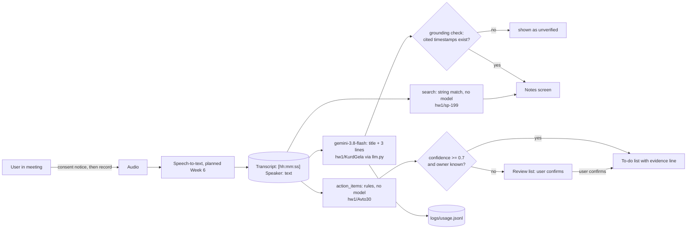

# Design Review · OpusFocus · Team OpusFocus

Members: NAME_SP199 · sp-199 · repo keeper — NAME_AVTO30 · Avto30 · spec keeper — Luka Kurdgelaidze · KurdGela · eval keeper · Repo: https://github.com/sp-199/OpusFocus · Graded commit: tag `design-review`

## 1 · Problem, users, success criteria

**Problem.** In meetings and lectures people either listen or take notes, rarely both. Notes typed live are incomplete; full recordings are never re-listened to. Existing AI note takers produce confident summaries and to-do lists with no way to check where a claim came from, so a wrong action item ("Giorgi will ship Friday") is trusted as fact.

**Users.** Students in weekly group-project meetings and lectures, and small teams with weekly syncs. They need the to-do list and the gist within a minute of the meeting ending, and need to check any line against what was actually said. Full spec: [`docs/spec.md`](spec.md).

| # | Success criterion | Measured by | Today |
|---|---|---|---|
| S1 | Every action item and summary line cites a transcript timestamp that exists, or is shown as unverified | `hw1/Avto30` and `hw1/KurdGela` tests; golden g3, g5 | 16 tests passing; g3 fails (duplicate), g5 live run below |
| S2 | Hedged or ownerless action items go to review, never to the to-do list | `test_hedged_line_is_flagged_not_accepted`, `test_unknown_owner_goes_to_review` | passing |
| S3 | Keyword search returns every matching line with timestamp, or "0 matches" | golden g1, g2 | 2/2 pass |
| S4 | Median cost per 30-minute meeting under $0.02, p95 latency under 10 s | `logs/usage.jsonl` | see section 5 |

## 2 · Architecture and data flow

| Model call | Model id | Input | Output | Validated by |
|---|---|---|---|---|
| summary | `google/gemini-3.8-flash` (OpenRouter) | system prompt + whole transcript (≤ 60k chars) | JSON `{title, summary[3]}`, each line ending in `[hh:mm:ss]` | JSON parse, 3 lines, title ≤ 60, every cited timestamp checked against the transcript (`hw1/KurdGela/src/summarize.py`) |
| speech-to-text | provider TBD (Week 6) | audio | timestamped transcript | planned: format check before anything downstream runs |

**Non-obvious arrows.** *Transcript → summary:* the transcript is passed as data; the system prompt says spoken instructions are ignored (tested by golden question 3 in `hw1/KurdGela`). *Grounding check → unverified:* a summary line whose timestamp is not in the transcript is never shown as fact. *Confidence → review list:* this is where the human is in the loop (Week 3 pattern): the user confirms low-confidence items; they are never prefilled into the to-do list. Retrieval (Lab 4): we do not retrieve across documents yet; a single meeting fits in context (see section 5), and cross-meeting search is the planned RAG slice.

## 3 · Risks and safety threats

| Risk | What a user would see | Mitigation (link, or plan and week) | Owner |
|---|---|---|---|
| Invented action item or fact in the summary | "Giorgi will ship Friday" when he never said it | every item carries its verbatim evidence line (`hw1/Avto30`); summary lines must cite existing timestamps, otherwise flagged (`hw1/KurdGela`) | Avto30 |
| Recording without consent; private audio leaked | someone recorded without knowing; their words stored | consent notice before recording; delete audio after transcription; fictional data only in the repo, no `.env` committed (`.gitignore`) — planned Week 6 | sp-199 |
| Prompt injection spoken in the meeting | the title says "Budget approved" because someone said "ignore previous instructions" | transcript treated as data in the system prompt; golden question 3 in `hw1/KurdGela`; red-team set planned Week 12 | KurdGela |
| Duplicate or hedged commitments counted as firm | the same task twice; "maybe" treated as a promise | hedges capped at 0.4 and sent to review (tested); duplicate case is golden g3, failing, fix planned Week 6 | Avto30 |
| Cost grows with meeting length and Georgian | a 2-hour Georgian lecture costs 10× a short English sync | every call logged with cost; 60k-character cap; chunking planned Week 7 | KurdGela |
| Provider outage or price change | summary fails or costs double | model is one env var (`OPUSFOCUS_MODEL`, [0002](decisions/0002-gateway-and-model.md)); search and action items work without any model ([0001](decisions/0001-rules-before-models.md)) | sp-199 |

## 4 · Evaluation plan

- Golden set: [`evals/golden.yaml`](../evals/golden.yaml) (5 questions: factual, edge, reasoning, refusal, format) · runner: `python evals/run_golden.py` · last offline run: [`evals/results/2026-10-20-2257-offline.json`](../evals/results/2026-10-20-2257-offline.json) · result: **3/4 scored pass (75%)**, g5 needs the live model.
- Live run: RUN_ME (`python evals/run_golden.py --live`, result file: RUN_ME).
- **What failed and why.** g3: the action-item rules read each line alone, so Mariam's "I will do that before Thursday" (answer to "Mariam, can you…") becomes a second firm item. Fix: merge adjacent "can you" / "I will" pairs from the addressee.
- **By Week 11:** 10 questions (3 factual, 2 reasoning, 2 edge, 2 refusal, 1 format) on at least three transcripts, including one Georgian and one with an injection attempt. The 0.70 gate blocks any merge that drops the pass rate below 70%, run in CI on every pull request.

## 5 · Token budget

| Feature | Model | Tokens in / out | Cost per request | Latency | Source |
|---|---|---|---|---|---|
| search | none | 0 / 0 | $0 | < 50 ms | `hw1/sp-199` |
| action items | none | 0 / 0 | $0 | < 50 ms | `hw1/Avto30` |
| summary (3-minute sample) | `google/gemini-3.8-flash` | RUN_ME | RUN_ME | RUN_ME | `logs/usage.jsonl`, live runs of `hw1/KurdGela` on 2026-10-20 |

**Napkin, from the measured sample.** A 30-minute English meeting is about 4,500 words ≈ 6,000 tokens in, ~150 out → about $0.005 at $0.75 / $3.75 per million (slide prices, to verify on openrouter.ai). Georgian costs 2–4× more tokens. **Monthly** at 50 users × 2 meetings per working day × 22 days = 2,200 summaries ≈ **$11 English, up to $44 Georgian.**

**RAG or long context.** One meeting (≤ 15k tokens) fits in context at under 1 cent, so a single-meeting summary uses long context and no retrieval. Searching across a semester of meetings (≈ 30 meetings × 6k = 180k tokens per question ≈ $0.14 each) does not; that slice will use retrieval with k=5 chunks (≈ 2k tokens, ≈ $0.002 per question).

## 6 · Team, roles and decisions

- Team contract: [`TEAM-CONTRACT.md`](../TEAM-CONTRACT.md) on `main` · roles: sp-199 repo keeper, Avto30 spec keeper, KurdGela eval keeper.
- Decision records: [0001 rules before models](decisions/0001-rules-before-models.md) · [0002 gateway and model](decisions/0002-gateway-and-model.md).
- Agent use: drafted with Claude, logged in [`docs/delegation-log.md`](delegation-log.md); each member reviewed their own section.
- **Next:** speech-to-text and consent flow (sp-199, Week 6); merge duplicate action items (Avto30, Week 6); 10-question golden set and CI gate (KurdGela, Week 11).
